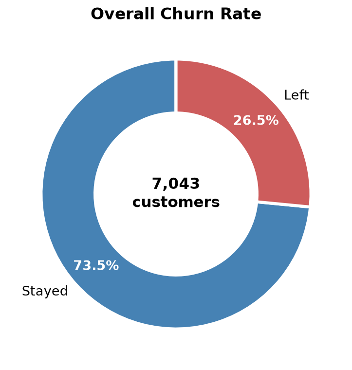
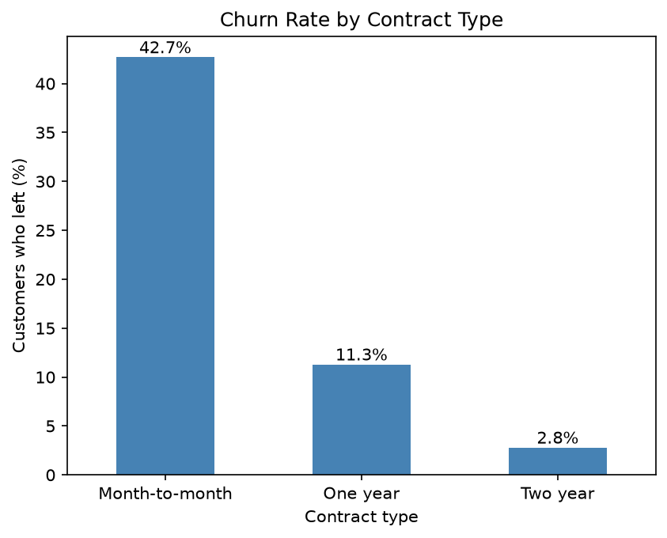
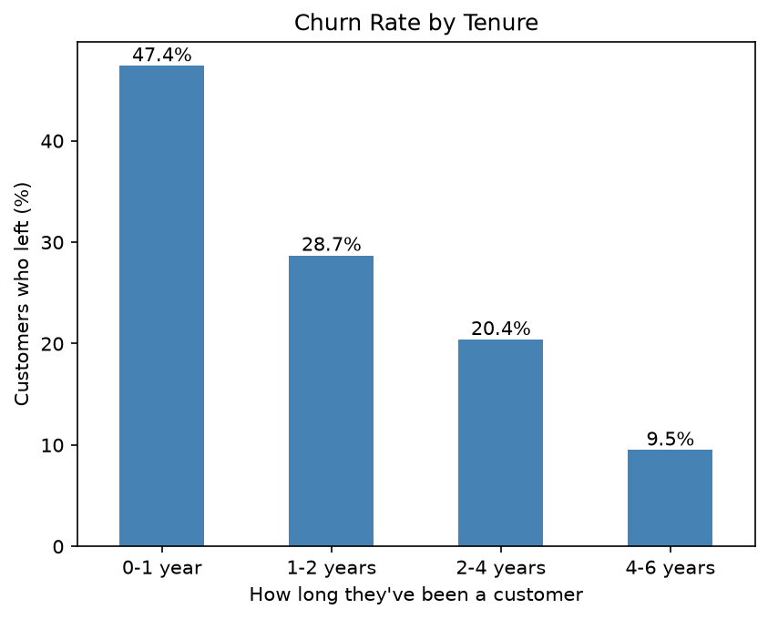

# Telecom Customer Churn Analysis

Analysing why customers leave a telecom company, using Python, pandas and matplotlib.

## Project Overview
Customer churn (customers leaving) is costly for telecom companies. This project explores 7,043 customer records to find out which customers are most likely to leave, and why.

**Data source:** [Telecom Customer Churn dataset on Kaggle](https://www.kaggle.com/datasets/alipakzad/telecom-customer-churn)

## Tools Used
- **Python**: data analysis
- **kagglehub**: downloading the dataset directly from Kaggle with code
- **pandas**: cleaning and analysing the data
- **matplotlib**: creating charts
- **Jupyter Notebook**: documenting the analysis
- **AI(Claude)**: used in some code writing and guidance

## Data Cleaning
- TotalCharges was stored as text because 11 values were blank
- All 11 were brand-new customers (tenure = 0) who had not been billed yet, so the blanks were filled with 0

## Key Findings
- **Overall churn:** 26.5% of customers left the company
- **Revenue impact:** customers who left took away 30.5% of monthly revenue, about 1.67 million per year
- **Contract type:** month-to-month customers had a churn rate of 42.7%, compared with 6.8% for one- or two-year contracts
- **Monthly charges:** customers who left paid 74.40 per month on average, compared with 61.30 for those who stayed
- **Tenure:** 47.4% of customers left in their first year, falling to 9.5% for customers of 4–6 years

- ## Charts

## Recommendation
Focus on keeping customers through their first year, for example by offering discounted rates for the first few months and a discount for switching to a one-year contract.

## Files
- `churn_analysis.ipynb`: the full analysis with code, charts and notes
- `telecom_churn_clean.csv`: the cleaned dataset

## Author
**Yesirat Ganiyu**: [LinkedIn](https://www.linkedin.com/in/yesirat-ganiyu/)
